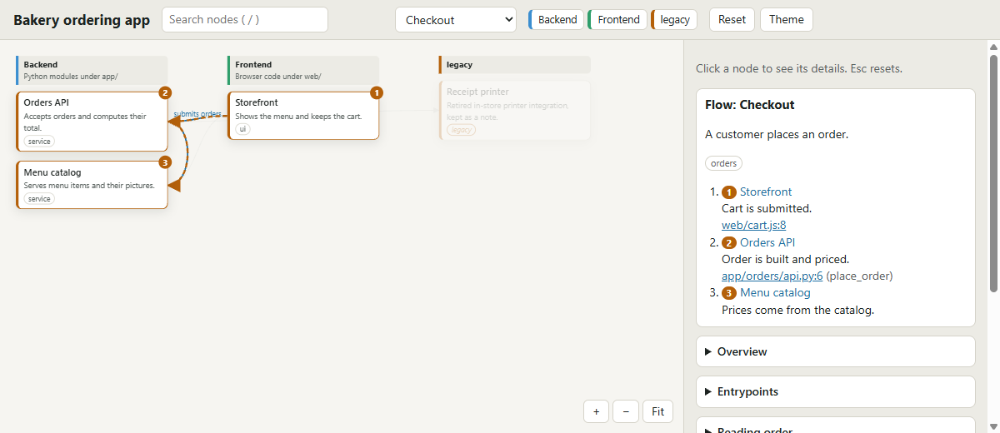

# archmap

archmap keeps an architecture map that a coding agent reads before it opens the code, and
fails the build when the map and the code disagree.

A hand-written `ARCHITECTURE.md` is accurate on the day it's written and drifts after the
next refactor. archmap stores the map as data. `docs/architecture-map.json` lists the
project's components, the files each one owns, how they call each other, and the main flows
step by step with `file:line` references. `archmap check` reads it next to the code and
reports paths that no longer exist, source files no component owns, edges to missing
components, and strings that look like credentials. Put it in CI, and a change that moves
code without updating the map fails.

`archmap build` turns the same file into one offline HTML page:



archmap is a single Python file that uses only the standard library and needs Python 3.10
or newer. There's nothing to install, and it makes no network calls.

## Quick start

```
mkdir -p tools/archmap
curl -L -o tools/archmap/archmap.py https://github.com/montesemasping/archmap/releases/latest/download/archmap.py
python tools/archmap/archmap.py check
```

Without a map, `check` exits with code 2 and says so. Write `docs/architecture-map.json`
starting from the example in
[`tests/fixtures/bakery/docs/architecture-map.json`](tests/fixtures/bakery/docs/architecture-map.json),
or let a coding agent write it with the [agent skill](#agent-skill). Then add the `check`
line to your CI.

## Install: one file

A project vendors a single file and needs nothing else (no pip, no dependencies).

1. Download `archmap.py` from a [release](https://github.com/montesemasping/archmap/releases).
   The release also carries `archmap.py.sha256` to verify it against.
2. Put it at `tools/archmap/archmap.py` in your project and commit it.

The build is deterministic, so you can make the same file yourself: check out a release
tag and run `python tools/build_single.py`, which writes `dist/archmap.py`.

The file is generated. Do not edit it; replace it with a newer release to upgrade.

### In the project's CI

```
python tools/archmap/archmap.py check
```

Exit codes:

- `0`: the map is clean.
- `1`: the guard reported problems.
- `2`: the map file is missing or is not valid JSON, the `--root` is not a directory, or an
  internal error occurred (printed as `archmap: internal error: <type>: <message>`).

### Locally

```
python tools/archmap/archmap.py build
```

The viewer is written to `runtime/html-artifacts/architecture-map.html`
(override with `-o OUT`). `build` runs `check` first and uses the same exit codes. It
still writes the viewer when the guard reports problems, so you can read them there, with
two exceptions: it writes nothing for a map that is not `archmap/1`, and it refuses to
write HTML (exit 1) when any problem is `secret-suspect`, so a suspected secret is never
embedded in a page.

## Agent skill

`skills/architecture-map/SKILL.md` teaches a coding agent to read a map before exploring
the code, to keep it current in the same change, and to connect archmap to a new project
step by step. It is a starting point: copy it into your agent's skills directory and adapt
it to your projects (where your repositories live, how you review and merge).

With Claude Code it also installs as a plugin straight from this repository:

```
claude plugin marketplace add montesemasping/archmap
claude plugin install archmap@archmap
```

## Commands

```
archmap check [MAP] [--root DIR]            # validate the map against the schema and the repository
archmap build [MAP] [--root DIR] [-o OUT]   # check, then build the offline HTML viewer
archmap --version                           # print the version
```

`MAP` defaults to `<root>/docs/architecture-map.json`; `--root` defaults to the
current directory. With the package installed (`pip install -e .`) the same commands
run as `archmap ...` or `python -m archmap ...`.

## The `archmap/1` schema, briefly

Top level (all keys other than these are rejected):

- Required: `$schema` (must be `"archmap/1"`), `meta`, `nodes`, `edges`, `flows`.
- Optional: `reading_order`, `gotchas`, `unknowns`, `sections`.

`meta`:

- Required: `project`, `title`, `layers` (list of `{id, title?, hint?}`), `coverage`.
- Optional: `updated_at`, `purpose`, `stack`, `entrypoints`, `conventions`,
  `maintenance`, `source_url`, `secret_allow`.
- `coverage.core`: globs of the files the map must account for. Every core file has to
  appear in some node's `files`. `coverage.ignored`: `{glob, why}` entries that exempt
  files from that rule; `why` is required.
- `secret_allow`: `{match, why}` entries that silence a secret finding for one known
  harmless value. `match` is at least 6 characters; `why` is required.
- `source_url`: an `http://` or `https://` template with `{path}` and `{line}`
  placeholders, for example `https://host/org/repo/blob/main/{path}#L{line}`. The viewer
  uses it to link flow steps to source.

Content:

- `nodes[]`: `id`, `label`, `layer`, `summary` required; `kind`, `files`, `details`,
  `api`, `status`, `tech` optional. `files` may hold exact paths, directories (`dir/`)
  and globs. A single entry may not cover the whole tree: `*`, `**` and anything whose
  first segment is `**` (`**/*.py`) are rejected as `path-invalid`.
- `edges[]`: `from`, `to` required; `label`, `kind` optional.
- `flows[]`: `id`, `title`, `steps` required (at least 2); each step needs `node` and
  `note`, and may carry `path`, `line`, `symbol`.
- `reading_order[]`, `gotchas[]`, `unknowns[]`, `sections{}`: guidance shown in the
  viewer. A `path` in `reading_order`, `gotchas` or `unknowns` must exist (exact path or
  directory, no glob). A section needs a `title` and exactly one of `body` or `items`.

Paths and globs:

- Paths use `/`, are relative to the root, and are case-sensitive. A path or glob has at most
  128 segments.
- Globs support only `*` (any run of characters inside one segment), `?` (one character)
  and `**` (a whole segment, any number of directories). `[]` and `{}` are literal
  characters, not classes or alternatives.
- Globs are allowed only in `nodes[].files`, in `meta.coverage.core` and in
  `meta.coverage.ignored[].glob`. Everywhere else a path must be exact.

## Guard rules

`check` reports one line per problem, in the form `where: message [code]`. The codes:

| Group | Codes |
|---|---|
| Schema | `schema-missing`, `schema-unknown`, `section-missing`, `field-missing`, `field-invalid`, `field-unknown` |
| Identity and graph | `id-duplicate`, `layer-undeclared`, `edge-dangling`, `edge-self`, `node-orphan`, `step-node-missing`, `flow-too-short` |
| Paths | `path-invalid`, `path-missing`, `glob-empty`, `line-invalid` |
| Coverage | `coverage-core-empty`, `coverage-core-glob-empty`, `coverage-uncovered`, `coverage-ignore-no-why`, `coverage-ignore-unused` |
| Secrets | `secret-suspect`, `secret-allow-no-why`, `secret-allow-unused` |

Coverage and secrets, in detail:

- If the `ignored` entries together remove every core file, the guard reports
  `coverage-core-empty` ("ignored entries remove every core file"): the map would then
  guard nothing.
- Secret detection scans every string value (keys are not scanned). `secret_allow[].match`
  values are exempt, but the `why` of an entry is scanned like any other text.
- A suspect id or key is never echoed in full: `where` falls back to the index
  (`nodes[0]`), and a suspect key in a message is cut to its first 4 characters
  (`'AKIA…'`).
- JSON nested deeper than 200 levels is reported as `json-invalid`.

## Development

```
pip install -e .[dev]
pytest -q                          # tests against the package
python tools/build_single.py       # writes dist/archmap.py (git-ignored)
ARCHMAP_IMPL=dist pytest -q        # the same tests against the single file
```

## License

MIT, see [`LICENSE`](LICENSE).
